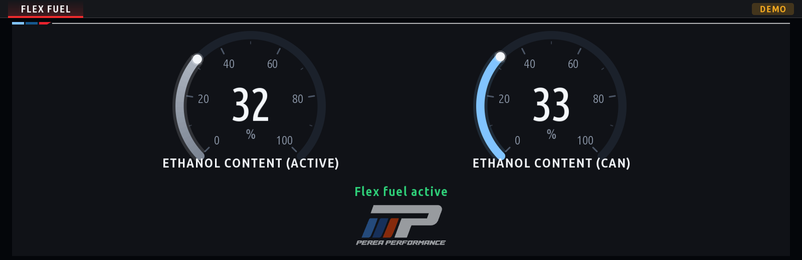

# Perea Performance iDrive apps

Apps for the BMW MGU head unit, iDrive 7 and (experimental, see below) iDrive 8, installed with the
[MGU Store](https://github.com/robertnisipeanu/mgu-store). They are built on the MGU App Kit
from [idrive7-apps](https://github.com/cauliflowermossgrape/idrive7-apps), reduced here to what
these apps use (see `THIRD_PARTY_NOTICES.md`). The Store builds each app on the head unit itself
from this repository: no BMW SDK leaves the car, and none is in this repository.

## Apps

| App | Id | What it does |
|---|---|---|
| **Flex Fuel** | `perea_mhd_flex` | The ethanol content an **MHD-flashed DME** runs on, as two dials: *Ethanol Content (Active)*, what the tune uses, and *Ethanol Content (CAN)*, what the flex fuel sensor reports; a third dial with the fuel in the tank (gallons and litres) and a **blend calculator**: how much ethanol to add to reach a target. Read-only over the car's own diagnostic link. Flags a map that ignores the sensor and a mismatch between the two. Details, protocol and how to add your ROM: [apps/perea_mhd_flex/README.md](apps/perea_mhd_flex/README.md). |



> **Experimental.** Flex Fuel's addresses were captured on one MHD ROM; on any other it says
> *ROM not supported* and sends no read. Use at your own risk, on your own car.

## Head units

| | iDrive 7 (ID7) | iDrive 8 (ID8) |
|---|---|---|
| Status | supported, in use | runs on a car (first seen 2026-11-11: oap-sdk 50.23.1, the Store's renderer); still young |
| Screen | drawn by a renderer, or by the HMI's own image (software path) | drawn by the Store's renderer only (the HMI has no image for it there) |
| Operation | touch and the iDrive controller | touch only |
| Settings | the kit's sheet, or the HMI's settings screen | the kit's sheet (the header's *Settings* tab) |
| Layout | full screen or standard | its own look: the same page centred on a grey backdrop that fills the screen between the HMI's title strip and the climate bar, a wide M flag at the top left, the tabs without the app's name |

One app serves both: its package carries a UI description for each HMI and the head unit takes its
own. What a unit builds is for that unit (its own `oap-sdk`, the manifest and ACL tables of its app
manager), which is why the Store builds the app on the head unit. The kit tells the HMI by a marker
only the iDrive 8 description has and follows the lifecycle proven there by the MGU Store's own app
and [IterioDev's apps](https://github.com/IterioDev/car-apps); everything it does differently on
iDrive 8 sits behind that check, and the iDrive 7 output is compared with snapshots in the tests.

**If something is off on an iDrive 8 car.** Settings → **Show diagnostics** (offered there only)
draws, in the page's left margin, what the kit found (HMI, SDK, renderer socket and dialect, screen,
app area, placement, SOME/IP backends). If the app does not draw at all, the HMI's own page says
why. Please send a photo of the screen and, from the app's data folder
(`/var/opt/public/oap/oap_<uid>/data/`), `perea_mhd_flex.log` and `perea_mhd_flex-diag.json`. Should the HMI refuse the app's page there (no tile, or
`initialize: INVALID_PARAMETER` in the log), `"id8Labels": false` in the app's `app.json` builds the
iDrive 8 description as a bare host state, without the note and marker labels.

## Install

The apps need a renderer on the head unit (`needs: ["renderer"]` in `mgu-repo.json`): the
Store's own Renderer, or `idrive7-renderd` if you already have it. The Store says so and offers
one when none is installed.

**A. From GitHub, in the Store.** Settings → **Add source** → `alexpereap/pereaperformance-idrive7-apps`,
following the **main** branch. The apps appear in the Store's list; pick one and install. The
head unit builds it (the Store installs its Python tool first, once).

**B. From a USB stick, offline.** Clone the Store's repository on your computer (Node 18 or
newer, or the standalone executable from the Store's `installer` release), write the stick, and
install from the Store's **USB** page:

```sh
git clone https://github.com/robertnisipeanu/mgu-store.git
```

```sh
node mgu-store/deploy/mgu-install.js usb-repo /media/<your-stick> /path/to/pereaperformance-idrive7-apps
```

(On iDrive 8 an app installs at the head unit's next start unless the Store's live hook is on.)

It copies this repository's tracked files to `<stick>/mgu-repo/<name>/`; the head unit builds
the apps from there. Run it again after a change: the Store offers an app again only when its
`version` in `app.json` went up.

**C. A package built with your own SDK.** With `oap-sdk/` extracted from your unit (below),
`python3 kit/tools/build.py perea_mhd_flex` writes `dist/perea_mhd_flex@<version>.tgz`; put it
on the stick with `usb-repo /media/<your-stick> dist/perea_mhd_flex@<version>.tgz`. The `.mgu`
and `.tgz` files contain BMW's SDK: keep them for your own car.

## Develop

Needs Node (18 or newer on the computer; the apps themselves run on the unit's Node 8, so no
`?.` or `??` in app code) and Python 3.

**The SDK from your unit** (only for installable builds; previews and tests need none):

```sh
scp root@<unit>:'/usr/lib/oap-mainapp/preinstalled_apps/x_call@*.tgz' .
mkdir x_call && tar xzf x_call@*.tgz -C x_call
node kit/tools/extract_sdk.js x_call/javascript/app.js     # writes ./oap-sdk/ (gitignored, never commit it)
```

**Build, preview, emulate, test:**

```sh
python3 kit/tools/build.py --preview-only perea_mhd_flex              # stage dist/perea_mhd_flex (no SDK)
python3 kit/tools/build.py --language zh-CN --preview-only perea_mhd_flex   # ko, ru, zh-CN: fixed-language packages
python3 kit/tools/build.py perea_mhd_flex                             # with oap-sdk/: dist/perea_mhd_flex@<ver>.tgz and .mgu
node kit/tools/preview.js dist/perea_mhd_flex out/                    # frames as PNG (demo data)
node kit/tools/emu.js perea_mhd_flex                                  # the app in the browser: http://localhost:8077 (docs/emulator.md)
node kit/tools/test_mhd_flex.js                                       # the app: protocol, states, screen, main
node kit/tools/test_runtime.js                                        # the kit: display, renderer client, settings sheet
node kit/tools/test_locales.js                                        # every language: catalogs, labels, glyphs
```

`build.py` with no app id builds every app in `apps/`.

## Adding an app

1. `apps/<id>/app.json` and `main.js`: the id lower-case with the `perea_` prefix (the Store
   wants ids unique across sources), a `loggingId` of its own, `version` x.y.z. Flex Fuel is
   the example: `mgu.run({ start(ctx) })`, `ctx.loop`, `ctx.canvas`, `G.radial`, the generated
   Settings screen.
2. `apps/<id>/icon.png` (the Store shows it; 128 KiB at most):
   `node kit/tools/make_icon.js <glyph> apps/<id>/icon.png`.
3. Its test in `kit/tools/`, run from `.github/workflows/tests.yml`.
4. Nothing to change in `mgu-repo.json`: every folder in `apps/` with an `app.json` is an app.
   A kit module the app needs that is not here yet (`car.js`, `dids.js`, ...) is taken from
   upstream idrive7-apps, with its notice.

## Translations

The packages are fixed-language: English, or Korean (`ko`), Russian (`ru`), Chinese (`zh-CN`)
with `--language`. The catalogs are `kit/runtime/locales/<lang>.tsv` (`English<TAB>translation`,
the key is the exact English text; every `app.json` label with a space must have a row) and
hold only the rows the apps here show.

1. Add the rows to the three TSVs, then `python3 kit/tools/sync_locales.py` (writes the JSON).
2. `python3 kit/tools/prune_locales.py --check` must pass (a row nothing shows is refused;
   `prune_locales.py` without `--check` drops it). Strings the kit draws by itself are on the
   script's `KEEP` list.
3. New characters need their glyphs baked: `python3 kit/tools/bake_cjk.py` for Chinese
   (downloads Noto Sans SC, checksum verified; Pillow needed), `python3 kit/tools/bake_korean.py`
   for Korean (Noto Sans CJK KR installed). The Latin and Cyrillic atlases
   (`bake_fonts.py`, `bake_cyrillic.py`) cover fixed character sets and only need a rebake if
   that set changes; they need the **variable** `Ubuntu[wdth,wght].ttf`, not the static
   Ubuntu-R/B files, or the glyph widths and weights change.
4. `node kit/tools/test_locales.js`: builds every app in every language and checks that every
   character of every translation has a glyph.

## Licences

- This repository: MIT, Copyright (c) 2026 Alex Perea (`LICENSE`).
- The MGU App Kit it is built on: MIT, Copyright (c) 2026 cauliflowermossgrape, with the
  Chinese translation Copyright (c) 2026 小白151 (JackieZ123430), the Russian by Иван
  (Fieldistor) and the Korean by jaimeen shim. Fonts under the Ubuntu Font Licence and the SIL
  OFL; the emulator's draw engine (mgu-render) GPL-3.0-or-later, source included. All of it in
  `THIRD_PARTY_NOTICES.md`.
- BMW's SDK and the `.mgu` / `.tgz` packages that contain it are never published.
